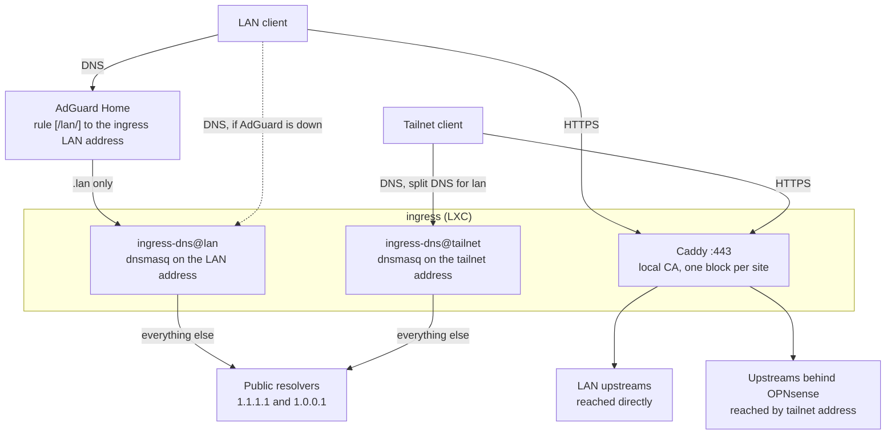

# Ingress

HTTPS names under `.lan` for the web UIs in a homelab, such as
`https://grafana.lan` and `https://proxmox.lan`, reachable from the home LAN
and from the tailnet. One small Debian LXC, named `ingress`, runs Caddy as the
reverse proxy and two dnsmasq instances as the DNS for `.lan`. Everything is
rendered from two small tab-separated files, `sites.tsv` and `hosts.tsv`.

## Why a separate host

The home LAN cannot reach the guests behind OPNsense, and those guests cannot
reach the Proxmox UI. A box that sits on the home LAN bridge and is also a
tailnet node reaches both sides: upstreams on the LAN directly, and upstreams
behind OPNsense by their tailnet addresses. Putting the proxy there, instead of
on any one guest, means one place holds the names, the certificates and the
DNS, and no guest needs to be reachable from another.

## What you get

- **One name per web UI.** `https://<name>.lan` for every line of `sites.tsv`,
  with a certificate from Caddy's own certificate authority. No browser
  warnings once a device trusts the root ([Certificates](certificates.md)).
- **Verified upstreams.** An `https` upstream is checked against a CA file you
  supply, with an optional name to check it against ([Sites](sites.md)). An
  `http` upstream that builds `http://` redirects is rewritten back to `https`.
- **Tailnet-only sites.** A site marked `tailnet` resolves to the ingress
  tailnet address only, and Caddy drops any client outside the tailnet.
- **DNS that keeps working.** Both dnsmasq instances answer `.lan` themselves
  and forward every other name to public resolvers, so the ingress address can
  be the router's second DNS server ([DNS](dns.md)).
- **Plain host records.** `hosts.tsv` gives machines a `<name>.lan` address
  record for ssh and the like, with no proxy involved.

## How it fits together

A LAN client asks AdGuard Home, which sends only `.lan` questions to the
ingress LAN address. The router also hands out the ingress LAN address as a
second DNS server, so a device that cannot reach AdGuard asks the ingress
instance directly and still resolves both `.lan` and the internet. A tailnet
client sends `.lan` questions to the ingress tailnet address through Split
DNS. The two instances answer with different addresses for the same names,
which is why there are two of them ([DNS](dns.md#why-two-instances)).

## Prerequisites

| Needed | What |
|---|---|
| A host | A Debian 13 LXC or VM on the LAN bridge, with `/dev/net/tun` ([Setup](setup.md#create-the-lxc)) |
| Packages | `caddy` from the official Caddy apt repository, `tailscale` from `pkgs.tailscale.com`, `dnsmasq`, `bind9-dnsutils`, `curl`, `openssl`, `iproute2` |
| Tailnet | The host joined with its own tag, so access rules can name it |
| Upstream CAs | For each `https` upstream, the PEM of the CA that signed its certificate |
| Data | `/etc/ingress/sites.tsv` and `/etc/ingress/hosts.tsv`, from the examples in this module |

The installer installs no packages and is a dry run unless given `--apply`.
Real site data never goes in this repository: the module ignores a
`sites.tsv` or `hosts.tsv` placed next to the examples, and the examples use
addresses from the documentation ranges only.

## Files

| Path | Job |
|---|---|
| `render.sh` | Turns the two data files into the Caddyfile, the host files and both dnsmasq configs. Writes only into the directory it is given |
| `install.sh` | Renders, validates, installs and reloads. Dry run by default |
| `verify-target.sh` | Picks the site and address `install.sh` checks over `https` after an apply |
| `systemd/ingress-dns@.service` | One template unit: `ingress-dns@lan` and `ingress-dns@tailnet` |
| `sites.example.tsv` | Example of the site data |
| `hosts.example.tsv` | Example of the host records |

## Where to go next

1. [Setup](setup.md): create the LXC, install, and wire the rest of the network to it.
2. [Sites](sites.md): the two file formats and every rule they are checked against.
3. [Certificates](certificates.md): trust the root on each device, and what that costs.
4. [DNS](dns.md): the two instances, the fallback behaviour and the AdGuard and Tailscale settings.
5. [Operations](operations.md): add a site, read the logs, check, roll back.
