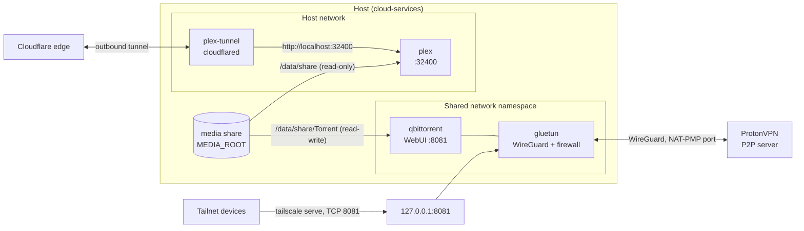

# Media stack

Plex and qBittorrent on one host, as a Docker Compose project named `media`.
The stack lives in `compose.yaml`; `install.sh` copies it to `MEDIA_DIR`
(default `/opt/media`) and starts it. Everything that differs per host is in
`MEDIA_DIR/.env`, created from `.env.example` on the first run.

## What runs

| Service | Image | Network | Job |
|---|---|---|---|
| `plex` | `plexinc/pms-docker` | host | Plex Media Server on `:32400`, reads the media share read-only |
| `plex-tunnel` | `cloudflare/cloudflared` | host | Remote access to Plex through an existing remote-managed Cloudflare tunnel whose ingress is `http://localhost:32400` |
| `gluetun` | `qmcgaw/gluetun` | its own, published on `127.0.0.1` only | ProtonVPN WireGuard client with NAT-PMP port forwarding, and the firewall for everything behind it |
| `qbittorrent` | `lscr.io/linuxserver/qbittorrent` | `service:gluetun` | The torrent client. It has no network of its own |

Image tags are pinned in `compose.yaml`. See [Operations](operations.md) for
how to bump one.

## Architecture

`plex` and `plex-tunnel` both use the host network. The tunnel's ingress is
`http://localhost:32400`, so it reaches Plex with no change to the tunnel's
configuration in Cloudflare.

`qbittorrent` has `network_mode: service:gluetun`, so it shares gluetun's
network namespace: the same interfaces, the same routes and the same firewall.
gluetun publishes qBittorrent's WebUI port on the host, on `127.0.0.1` only,
because published ports belong to the container that owns the namespace.

The media share is mounted inside both containers at `/data/share`, the path
the Plex libraries and the qBittorrent save paths were created with. Plex
mounts all of `MEDIA_ROOT` read-only. qBittorrent mounts only
`MEDIA_ROOT/Torrent`, read-write, at `/data/share/Torrent`.

## What is exposed where

| Endpoint | Reachable from | Protected by |
|---|---|---|
| Plex `:32400` on the host | The host's LAN | Plex's own sign-in |
| Plex through Cloudflare | The internet | The tunnel (outbound only, no router port) and Plex's own sign-in |
| qBittorrent WebUI `127.0.0.1:8081` | The host | The WebUI login |
| qBittorrent WebUI over the tailnet, TCP 8081 | Tailnet devices, only if `tailscale serve` is set up | Tailnet access rules and the WebUI login |
| The torrent listen port | The internet, through the VPN's forwarded port | Nothing else: it is the BitTorrent port |

The reasoning behind each row is in [Security](security.md).

## Where to go next

- [Setup](setup.md): install the stack on a host.
- [Secrets](secrets.md): the two files you create before the VPN and the tunnel start.
- [Operations](operations.md): day-two tasks.
- [Migration](migration.md): move an existing Plex and qBittorrent in.
