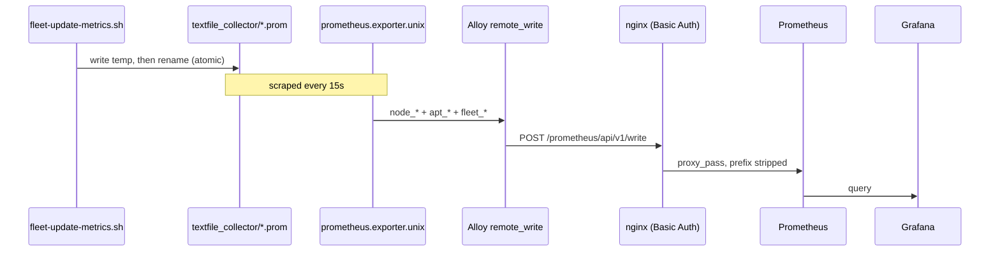
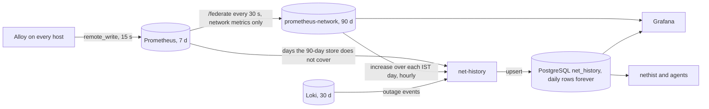
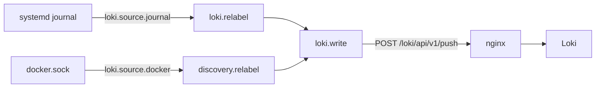

# Data flow

What each component emits, and how it reaches a dashboard.

## Metrics



Three exporters feed the same remote-write pipeline:

| Component | Job label | Emits |
|---|---|---|
| `prometheus.exporter.unix` | `integrations/unix` | `node_*`, plus anything in the textfile directory |
| `prometheus.exporter.cadvisor` | `integrations/cadvisor` | `container_*` |
| Alloy self-scrape | `alloy` | `prometheus_remote_storage_*`, component health |

External labels `host` and `role` are attached by Alloy from
`MONITOR_HOSTNAME` and `MONITOR_ROLE` in `/etc/default/alloy`.

!!! danger "Never rename `MONITOR_HOSTNAME`"
    Every `host=` label keys off it. Renaming forks the host's history in
    Prometheus: old series keep the old label forever and nothing joins them.
    `monitor-lxc` pins its value in `host_vars/` for exactly this reason.

Devices that cannot run Alloy (the firewall, the routers) are covered in
[Routers and firewall](../monitoring/routers.md#telemetry-flow): they are
scraped by the central Alloy or polled by a host on their LAN.

## Long-term network history

The network dashboards reach back further than the central Prometheus keeps data.
Three tiers sit behind them, plus the logs and the device ledgers:

| Tier | Keeps | Resolution | Where | Read by |
|---|---|---|---|---|
| Prometheus | every metric | 15 s, 7 days | `prometheus.service` on the central host, `127.0.0.1:9090` | all dashboards, alert rules; Grafana datasource `prometheus` |
| `prometheus-network.service` | only the network metrics (internet probe, ER605, OPNsense, TP-Link, tailnet and guest NICs) | 30 s, 90 days, capped at 4 GB | a second Prometheus on `127.0.0.1:9091` that federates `/federate` from the first | the four network dashboards by default, through the `ds` variable; Grafana datasource `prometheus-90d` |
| `net-history` | one row per IST day per key, forever, plus monthly views and every outage | 1 day, 1 month | PostgreSQL database `net_history` on the memory LXC, written hourly by `net-history.timer` | the "Monthly history (permanent)" row of those dashboards through the datasource `net-history`; `nethist` and the agent skill |
| Loki | journal lines, including the outage events | 30 days | `loki.service` | the Loki panels; `net-history` copies outage events into PostgreSQL |
| Device ledgers | hourly usage and every outage, on the device's host | 1 hour, forever | `usage.db`, `outages.db`, `segflows` state | `--report` of each poller; the ER605 ledger can seed `wan_daily` |



`net-history` computes each day with `increase()` evaluated at the end of the IST
day (Asia/Kolkata) and upserts today and the two days before on every run. The
role seeds the last 7 days once (`--backfill 7`, from the central Prometheus,
because the 90-day store starts empty); it does not back-fill further, and a
later `--backfill N` run recomputes N days from whichever store covers each day
best. A source that has no
data yet skips its table and the run still succeeds. The monthly views group the
daily rows; availability is recomputed from the sums of seconds, never averaged.
Run state is `net_history_run_success`, `net_history_last_run_timestamp_seconds` and
`net_history_rows{table}` ([metrics](../reference/metrics.md#network-history)).
The setup and every setting are in the
[`network_history` role](https://harshitruwali.github.io/homelab-infra/ansible/reference/playbooks/#network_history).

!!! info "A gap in the central Prometheus is a gap in the 90-day tier"
    The 90-day tier only copies what the central Prometheus has, and starts empty.
    `net-history` therefore asks both stores when their data for each table began,
    computes every day from the store that covers most of it, and stores that share
    as the row's `coverage`. A stored row is never replaced by one of lower
    coverage (today's row is always recomputed), and the monthly views count
    days below 1 as `partial_days`. Days before the role was deployed exist in
    PostgreSQL only as far back as the central 7 days reached, plus what was
    imported from the ER605 ledger with `--import-wan-daily` (source
    `er605-ledger`, which wins over Prometheus rows of lower coverage).

## The textfile bridge

Anything a shell script can compute becomes a Prometheus metric by writing a
`.prom` file into `/var/lib/node_exporter/textfile_collector/`.

```alloy
prometheus.exporter.unix "host" {
  textfile {
    directory = "/var/lib/node_exporter/textfile_collector"
  }
}
```

Two producers write there:

| File | Written by | Cadence |
|---|---|---|
| `fleet-updates.prom` | `fleet-update-metrics.sh` | every 15 min + at boot |
| `fleet-docker.prom` | `fleet-docker-update.sh` | after each container update |

!!! warning "Always write-then-rename"
    The collector will happily read a half-written file and export garbage.
    Both scripts write to a temp file in the same directory and `mv` it into
    place, because rename is atomic within a filesystem.

Free bonus: node_exporter emits `node_textfile_mtime_seconds` automatically,
so a script that dies silently is still centrally detectable.

## Logs



Label sets applied:

| Source | Labels |
|---|---|
| journal | `job="systemd-journal"`, `source="journal"`, `unit`, `level`, `host`, `role` |
| docker | `job="docker"`, `source="docker"`, `container`, `container_id`, `compose_service`, `host`, `role` |

`source` is what makes "journal vs container logs" a cheap query rather than a
regex over stream names.

!!! tip "The free audit trail"
    `Unattended-Upgrade::SyslogEnable "true"` puts every package action into
    the journal, which Alloy already ships. That gives a central, queryable
    record of every package applied on every host with no extra plumbing:

    ```logql
    {unit="unattended-upgrades.service"} |= "Packages that will be upgraded"
    ```

## Ingest path asymmetry

The nginx paths do **not** behave the same way, and getting this wrong
produces confusing 404s:

| Public path | Upstream receives | Note |
|---|---|---|
| `/prometheus/api/v1/write` | `/api/v1/write` | prefix **stripped** |
| `/loki/api/v1/push` | `/loki/api/v1/push` | prefix **preserved** |

So a Loki query URL is `/loki/api/v1/label/host/values`, not
`/loki/loki/api/v1/...`. Readiness probes follow the same rule:
`/prometheus/-/ready` and `/loki/ready`.

## Backpressure

Onboarding a fleet at once means backfilling a lot of journal history through
one ingest path. Three things keep that from failing:

```alloy
queue_config {
  capacity            = 10000
  max_shards          = 10
  batch_send_deadline = "5s"
  retry_on_http_429   = true   // retry rather than drop
}
```

- `retry_on_http_429 = true` on the collector side.
- Raised `ingestion_rate_mb` in `loki/loki-config.yml` on the server side.
- `alloy_journal_max_age` lowered to `1h` on hosts with enormous journals.

Without all three, starting `loki.source.journal` with a 12h `max_age` on
several hosts simultaneously **will** hit Loki's default 4 MB/s limit.
