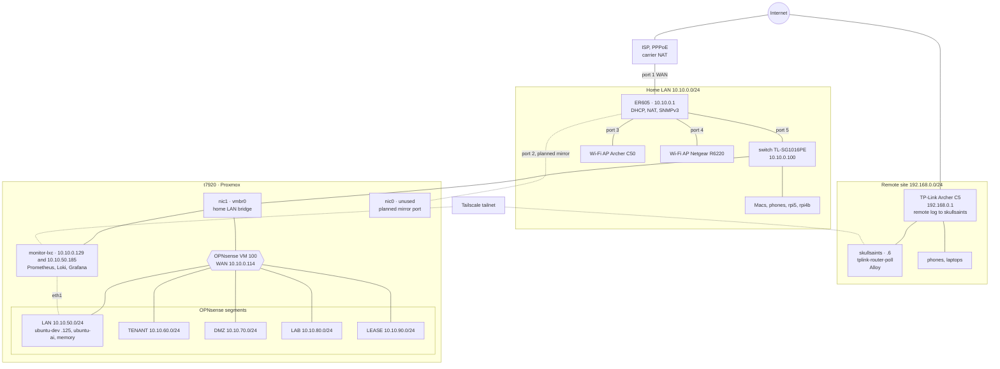
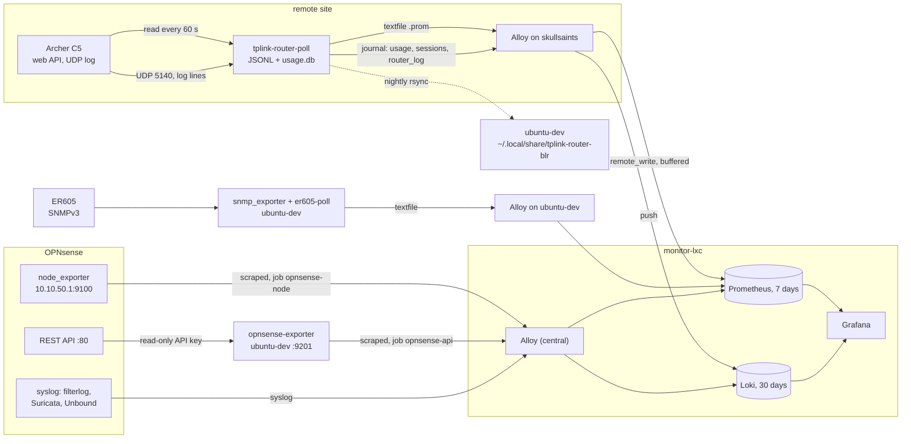

# Routers and firewall

What the stack collects from the network devices: the TP-Link router at the
remote site, OPNsense, and the home router (ER605). It covers how each one
reaches Grafana, and what is still planned. Host metrics (Alloy on Linux
guests) are in [Collectors](collectors.md); this page is about devices that
cannot run Alloy.

| Device | Collected by | What | Where | Status |
|---|---|---|---|---|
| TP-Link Archer C5 (remote site) | `tplink-router-poll` on skullsaints ([role](https://harshitruwali.github.io/homelab-infra/ansible/reference/playbooks/#tplink_router_poll)) | per-client usage, connections, Wi-Fi quality, the router's own log, a permanent usage ledger | [Router TPLink Blr](dashboards.md#router-tplink-blr) | live |
| OPNsense (VM 100) | the `os-node_exporter` plugin, and `opnsense-exporter` on ubuntu-dev ([role](https://harshitruwali.github.io/homelab-infra/ansible/reference/playbooks/#opnsense_exporter)) | host metrics, traffic per interface, firewall pass and block, states, gateways, services, firmware, Unbound | Prometheus jobs `opnsense-node`, `opnsense-api` | live; dashboard planned |
| OPNsense logs | syslog to the central Alloy | `filterlog`, Suricata, Unbound queries | Loki, [Suricata Alerts](dashboards.md#suricata-alerts) | live (before this page) |
| ER605 (home router) | SNMPv3 WAN counters | household internet totals | Prometheus `er605_*` | live, outside this repo |
| ER605 web API | a poller like the TP-Link one | WAN totals, CPU per core, memory, every DHCP client and when it joined and left, its log | | planned |
| Home LAN per-client usage | port mirror of the ER605 LAN ports to t7920 `nic0` | per-device bytes for every home device | | planned: needs one cable |
| Wi-Fi access points | their web UIs | per-device signal and link rate | | planned: needs their passwords |

## Network map



Solid lines are cables and bridges; dotted lines are planned links and the
tailnet. The full plan, with every address, firewall rule and change, is kept
outside this repository. Every homelab VM reaches the internet through
OPNsense, so the ER605 sees them all as one client, `10.10.0.114`. Per-VM
traffic is on the [Guest Traffic](dashboards.md#guest-traffic) dashboard,
read from the hypervisor.

## Telemetry flow



## TP-Link router at the remote site

A poller on a host on that LAN. The role page has the details:
[`tplink_router_poll`](https://harshitruwali.github.io/homelab-infra/ansible/reference/playbooks/#tplink_router_poll).

- **Usage per client** comes from the per-client Wi-Fi counters. The router's
  own internet counter and its statistics page miss traffic it forwards in
  hardware, so they are shown for comparison only.
- **When** comes from the connection records and the router's own log. The
  router sends its log to the poller host over UDP (its format is not RFC
  3164, so Alloy's syslog source rejects it).
- **How far back:** Prometheus keeps 7 days, Loki 30, and the usage ledger on
  the poller host keeps everything, with a nightly copy to ubuntu-dev.

## OPNsense

OPNsense is FreeBSD and outside Ansible. Four scripts, run once by hand on the
firewall, prepared it. Each defaults to a dry run that validates through
OPNsense's own models and saves nothing:
[`roles/opnsense_exporter/files/opnsense/`](https://github.com/HarshitRuwali/homelab-infra/tree/master/ansible/roles/opnsense_exporter/files/opnsense).

| Script | What it does on the firewall |
|---|---|
| `create-exporter-user.php` | user `prometheus-exporter` with a scrambled password, the read-only privileges the exporter needs, and one API key, printed once |
| `node-exporter-config.php` | the `os-node_exporter` plugin on the LAN address only, port 9100 |
| `rule-node-exporter.php` | a LAN rule letting only monitor-lxc reach port 9100 |
| `unbound-extstats.php` | Unbound extended statistics, which the DNS collector needs; restarts Unbound |

Run each the same way, after installing the plugin with `pkg install -y os-node_exporter`:

```bash
scp -i ~/.ssh/infra-worker <script>.php root@10.10.0.114:/root/
ssh -i ~/.ssh/infra-worker root@10.10.0.114 'cd /usr/local/opnsense/mvc && php /root/<script>.php'           # dry run
ssh -i ~/.ssh/infra-worker root@10.10.0.114 'cd /usr/local/opnsense/mvc && php /root/<script>.php --apply'   # apply
```

The firewall's root shell is csh: pipe anything longer through `sh -s`.

What arrives, with `host="opnsense"`, `role="firewall"`:

- **`opnsense-node`:** node_exporter, FreeBSD flavour: CPU, memory, load,
  filesystems, network devices.
- **`opnsense-api`:** `opnsense-exporter`:
  - traffic and errors per interface;
  - firewall pass and block packets per interface and direction;
  - TCP states;
  - pf state-table use against its limit;
  - mbufs;
  - gateways;
  - services;
  - cron jobs;
  - firmware and pending updates;
  - ARP entries;
  - Unbound.

The job names are not `integrations/unix`, so the Linux host alerts and fleet
dashboards do not match the firewall by accident.

!!! warning "`opnsense_up` is always 0 on OPNsense 26.7"
    The exporter's health check wants `/api/core/system/status` to report
    `metadata.system.status` as the number `2`; 26.7 returns the string `"OK"`.
    Every other collector works. Use `up{job="opnsense-api"}` and fresh data
    (`opnsense_interfaces_received_bytes_total`) to tell whether it is working.

## ER605 (home router)

Probed read-only on 2026-11-20 through its web API. The findings that shape the
plan:

- **Its per-IP statistics see about 4% of the traffic.** Summed over every
  address they showed 4.25 GB in and 2.75 GB out, against 111 GB and 72 GB on
  the WAN port over the same 6.5 days. The router forwards most traffic in
  hardware, past its counters, and this firmware has no switch to turn that
  off. Per-client usage for the home LAN cannot come from the router itself.
- **Reliable:**
  - WAN and port byte counters;
  - CPU per core and memory;
  - the DHCP client list;
  - the ARP table;
  - its log, which keeps only 50 lines.
- **Login:** the API is TP-Link's "luci" interface. It needs the script
  files fetched with a `Referer` of its own login page, a password
  RSA-encrypted with raw zero padding (`password_<uptime>`), and the
  configured username, which is not `admin`.

Planned:

1. **A poller** on the same pattern as the TP-Link one: WAN totals, CPU,
   memory, every client and when it joined and left (from the leases and the
   ARP table), and its log read every minute.
2. **Per-client usage by port mirror.** The ER605 copies its LAN ports (the
   switch and both Wi-Fi access points) to its free port, cabled to t7920's
   unused `nic0`, where a flow counter attributes every byte to a home device.
   It must be the LAN side, because past the router's address translation
   every device looks like the router. When the access points move onto the
   switch, only the switch port needs mirroring.
3. **Wi-Fi quality** from the two access points' web UIs.
