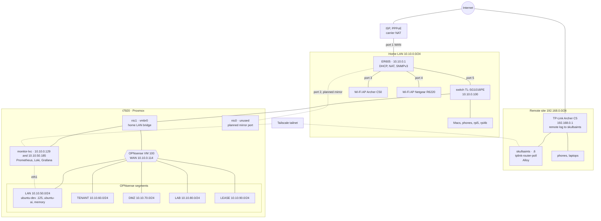
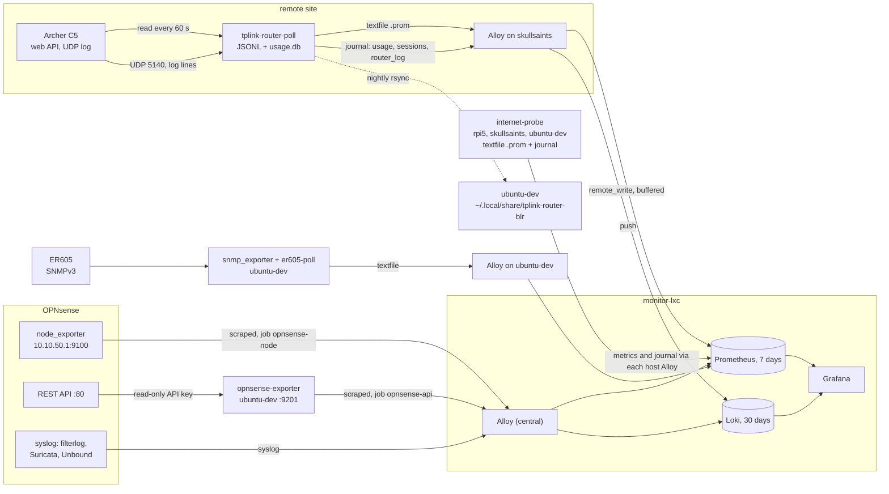

# Routers and firewall

What the stack collects from the network devices: the TP-Link router at the
remote site, OPNsense, and the home router (ER605). It covers how each one
reaches Grafana, and what is still planned. Host metrics (Alloy on Linux
guests) are in [Collectors](collectors.md); this page is about devices that
cannot run Alloy.

| Device | Collected by | What | Where | Status |
|---|---|---|---|---|
| TP-Link Archer C5 (remote site) | `tplink-router-poll` on skullsaints ([role](https://harshitruwali.github.io/homelab-infra/ansible/reference/playbooks/#tplink_router_poll)) | per-client usage, connections, Wi-Fi quality, the router's own log, a permanent usage ledger | [Router TPLink Blr](dashboards.md#router-tplink-blr) | live |
| Internet probe (every site) | `internet-probe` on rpi5 (home), skullsaints (blr) and ubuntu-dev (homelab) | whether the internet is reachable, outage start, end, cause and duration, probe latency | [Internet and Usage](dashboards.md#internet-and-usage) | live once deployed |
| OPNsense (VM 100) | the `os-node_exporter` plugin, and `opnsense-exporter` on ubuntu-dev ([role](https://harshitruwali.github.io/homelab-infra/ansible/reference/playbooks/#opnsense_exporter)) | host metrics, traffic per interface, firewall pass and block, states, gateways, services, firmware, Unbound | Prometheus jobs `opnsense-node`, `opnsense-api` | live; dashboard planned |
| OPNsense logs | syslog to the central Alloy | `filterlog`, Suricata, Unbound queries | Loki, [Suricata Alerts](dashboards.md#suricata-alerts) | live (before this page) |
| ER605 (home router) | `er605_snmp` on ubuntu-dev ([role](https://harshitruwali.github.io/homelab-infra/ansible/reference/playbooks/#er605_snmp)): SNMPv3 through a local snmp_exporter, and a poller | household internet totals, hourly usage ledger, PPPoE reconnects, router reboots, CPU per core, memory, interface state | [Home ISP](dashboards.md#home-isp), Prometheus `er605_*` | live once the role is deployed; see [ER605](#er605-home-router) |
| ER605 web API | a poller like the TP-Link one | every DHCP client and when it joined and left, its log | | planned |
| Home LAN per-client usage | port mirror of the ER605 LAN ports to t7920 `nic0` | per-device bytes for every home device | | planned: needs one cable |
| Wi-Fi access points | their web UIs | per-device signal and link rate | | planned: Archer C50 login verified, no clients at the time; Netgear R6220 was off |

## Network map



Solid lines are cables and bridges; dotted lines are planned links and the
tailnet. The full plan, with every address, firewall rule and change, is kept
outside this repository. Every homelab VM reaches the internet through
OPNsense, so the ER605 sees them all as one client, `10.10.0.114`. Per-VM
traffic is on the [Guest Traffic](dashboards.md#guest-traffic) dashboard,
read from the hypervisor.

## Telemetry flow



## Internet uptime

`internet-probe` runs on one host per site (rpi5 at home, skullsaints at the
remote site, ubuntu-dev for the homelab) and shows on
[Internet and Usage](dashboards.md#internet-and-usage). Every few seconds it
tries several public targets (TCP connects, raw DNS queries, one HTTP check) and
the site's default gateway. Status: live once the role is deployed; see the
[metrics](../reference/metrics.md) and the role page in the Ansible docs.

- **What counts as down:** a round where no TCP or DNS target answered (the HTTP
  check is informational). One failed round is a blip, logged but not counted.
  Two in a row make a confirmed outage, and the first good round ends it.
- **Local or upstream:** `cause=local` when the site's gateway did not answer
  in the confirming round (the router, cable or host's own network); `upstream`
  when the router answered and the internet did not (the ISP or beyond).
- **Where history lives:** Prometheus keeps 7 days of metrics, Loki keeps 30
  days of the journal lines (`outage_start`, `outage_end`, `blip`), and the
  ledger on each probe host (SQLite, written only on outage changes) is kept
  forever and read with `internet-probe.py --report outages` or `--report daily`.
- **Limits:** the home probe (rpi5) sits on the same LAN as the central
  stack, so a home outage does not cut it off. skullsaints' Alloy buffers
  metrics on disk (remote_write WAL) and replays them once the link returns, so
  a Bangalore outage usually fills in afterwards. Only journal lines older than
  Alloy's retry window can be lost from Loki; the ledger on the probe host always
  has every outage. A restart during an outage closes it with `closed_by=restart`.
  The Ledger stat turns red if the poller cannot write its ledger.

## TP-Link router at the remote site

A poller on a host on that LAN. The role page has the details:
[`tplink_router_poll`](https://harshitruwali.github.io/homelab-infra/ansible/reference/playbooks/#tplink_router_poll).

- **Usage per client** comes from the per-client Wi-Fi counters. The router's
  own internet counter and its statistics page miss traffic it forwards in
  hardware, so they are shown for comparison only.
- **When** comes from the connection records and the router's own log. The
  router sends its log to the poller host over UDP (its format is not RFC
  3164, so Alloy's syslog source rejects it).
- **How far back:** Prometheus keeps 7 days, Loki 30, and the usage ledger on
  the poller host keeps everything, with a nightly copy to ubuntu-dev.

## OPNsense

OPNsense is FreeBSD and outside Ansible. Four scripts, run once by hand on the
firewall, prepared it. Each defaults to a dry run that validates through
OPNsense's own models and saves nothing:
[`roles/opnsense_exporter/files/opnsense/`](https://github.com/HarshitRuwali/homelab-infra/tree/master/ansible/roles/opnsense_exporter/files/opnsense).

| Script | What it does on the firewall |
|---|---|
| `create-exporter-user.php` | user `prometheus-exporter` with a scrambled password, the read-only privileges the exporter needs, and one API key, printed once |
| `node-exporter-config.php` | the `os-node_exporter` plugin on the LAN address only, port 9100 |
| `rule-node-exporter.php` | a LAN rule letting only monitor-lxc reach port 9100 |
| `unbound-extstats.php` | Unbound extended statistics, which the DNS collector needs; restarts Unbound |

Run each the same way, after installing the plugin with `pkg install -y os-node_exporter`:

```bash
scp -i ~/.ssh/infra-worker <script>.php root@10.10.0.114:/root/
ssh -i ~/.ssh/infra-worker root@10.10.0.114 'cd /usr/local/opnsense/mvc && php /root/<script>.php'           # dry run
ssh -i ~/.ssh/infra-worker root@10.10.0.114 'cd /usr/local/opnsense/mvc && php /root/<script>.php --apply'   # apply
```

The firewall's root shell is csh: pipe anything longer through `sh -s`.

What arrives, with `host="opnsense"`, `role="firewall"`:

- **`opnsense-node`:** node_exporter, FreeBSD flavour: CPU, memory, load,
  filesystems, network devices.
- **`opnsense-api`:** `opnsense-exporter`:
  - traffic and errors per interface;
  - firewall pass and block packets per interface and direction;
  - TCP states;
  - pf state-table use against its limit;
  - mbufs;
  - gateways;
  - services;
  - cron jobs;
  - firmware and pending updates;
  - ARP entries;
  - Unbound.

The job names are not `integrations/unix`, so the Linux host alerts and fleet
dashboards do not match the firewall by accident.

!!! warning "`opnsense_up` is always 0 on OPNsense 26.7"
    The exporter's health check wants `/api/core/system/status` to report
    `metadata.system.status` as the number `2`; 26.7 returns the string `"OK"`.
    Every other collector works. Use `up{job="opnsense-api"}` and fresh data
    (`opnsense_interfaces_received_bytes_total`) to tell whether it is working.

### Inter-segment traffic

How much flows between each pair of segments, and between hosts across
segments, comes from `segflows.py`, which reads the NetFlow records the firewall
already collects (`flowd`). It lives with the other firewall cron script,
`pfstats`, in
[`security/opnsense/segflows/`](https://github.com/HarshitRuwali/homelab-infra/tree/master/security/opnsense/segflows),
because it is installed on the firewall by an installer, not by Ansible.

Every 5 minutes (cron, as root) it reads the flows newer than the last run,
puts the source and destination of each into a segment by subnet (`LAN`,
`TENANT`, `DMZ`, `LAB`, `LEASE`, `HOME`, `TAILNET`, `FIREWALL`, `INTERNET`, plus
`LINKLOCAL` and `PRIVATE`; the list is in
[the metrics](../reference/metrics.md#inter-segment-traffic)) and writes two
things:

- the counters `opnsense_segflow_*` to
  `/var/tmp/node_exporter/segflows.prom`, which Prometheus keeps 7 days;
- a permanent SQLite ledger, `/var/db/segflows/ledger.sqlite` (the firewall's
  root filesystem is on disk, not memory): hourly (Asia/Kolkata hours) bytes, packets and flows per
  segment pair, and per day the 50 largest host pairs of each pair. It is never
  pruned and its size is bounded by design: 24 rows per pair per day plus at
  most 50 host-pair rows per pair per day.

A routed flow between two captured interfaces is exported twice, once by the
NetFlow node of each interface (ingress on the source side, egress on the
destination side), with the same 5-tuple and the same in and out interfaces. A
record cannot be traced to its node (the v9 header carries no per-node field),
so the second record is matched to the first as a twin: same 5-tuple and
interfaces, flow end within 2.5 s, arriving within 60 s. The pair counts once,
at the larger of the two byte and packet counts (pf can drop packets between
the two points). A flow that crosses one captured interface, such as any flow
to the internet or the home LAN, is one record and needs no matching. The
host-pair `port` is the lower of the two ports, the server side, so replies are
filed under the same service port as requests.

**Capture every internal interface first.** NetFlow captures TENANT and LEASE
(`opt1,opt4`) until told otherwise, so a flow between two other segments is not
seen. `netflow-capture.php` adds LAN, DMZ and LAB (`lan,opt2,opt3`); the WAN
stays uncaptured, because every flow to the home LAN or the internet is seen on
its internal interface. Copy it to the firewall and run it from
`/usr/local/opnsense/mvc`, like the other model scripts:

```sh
cd /usr/local/opnsense/mvc
php /root/netflow-capture.php                                 # dry run: prints the current and new list, saves nothing
php /root/netflow-capture.php --apply                         # save, then restart NetFlow as the GUI's Apply does
php /root/netflow-capture.php --interfaces lan,opt2 --apply   # add only these instead of lan,opt2,opt3
php /root/netflow-capture.php --revert --apply                # back to opt1,opt4
```

It only adds: every interface already in the list stays. It does not touch the
collector target (`127.0.0.1:2056`) or the version. `--apply` runs
`netflow stop`, `template reload OPNsense/Netflow`, `netflow start` and
`netflow aggregate restart` (the actions the NetFlow page's Apply runs), and
starts the collector if it is down. Restarting the nodes drops flows still open
in their caches, so expect a short gap. Capturing more interfaces multiplies
the flow records `flowd` writes, which shortens the raw history the ten
rotated logs hold and makes the aggregator work harder; check
`opnsense_segflow_run_duration_seconds` and the firewall's CPU afterwards.

**Install.** Copy `security/opnsense/segflows/` to the firewall and, as root
there (the shell is csh, so use `sh`):

```sh
cd segflows
sh install.sh            # dry run: prints what it would do, changes nothing
sh install.sh --apply    # files, configd action, cron job, one run, check
```

`--apply` runs the script once, which reads up to a day of `flowd` history, and
checks that `segflows.prom` carries the run, lag and capture metrics, and only
then adds the cron job. The script also takes a lock
(`/var/db/segflows/segflows.lock`) without waiting, so a run that overlaps
another does nothing and cannot add the same flows to the ledger twice. Remove it
with `sh install.sh --uninstall --apply`; that keeps `/var/db/segflows`, so
delete that directory by hand to drop the history. The installer does not touch
which interfaces NetFlow captures: run the capture step above first.

**Read the ledger.** On the firewall:

```sh
/usr/local/sbin/segflows.py --report pairs --days 7             # bytes per segment pair
/usr/local/sbin/segflows.py --report hosts --days 7 --segment DMZ   # top host pairs
/usr/local/sbin/segflows.py --report hour --days 1              # hourly rows
/usr/local/sbin/segflows.py --report day --days 30              # daily totals per pair
```

Times are Asia/Kolkata. `--segment X` keeps pairs where `X` is the source or
the destination. Reports read the ledger only and change nothing.

!!! warning "What it cannot see"
    Only traffic that crosses a NetFlow-captured firewall interface is a flow.
    The captured interfaces are listed in the dashboard's Coverage row (from
    `opnsense_segflow_capture_interfaces`); a flow between two segments that
    are both uncaptured is invisible. Traffic inside one segment or inside the
    home LAN switch never reaches the firewall at all, captured or not.
    Per-device home traffic needs the planned ER605 port mirror.

The [Inter-LAN dashboard](dashboards.md#inter-lan) shows the result next to the
inter-site connectivity probes. `ansible/tests/segflows-test.py` runs the
script on fixture flows.

## ER605 (home router)

### SNMPv3 monitoring

The household's internet use and the router's health come from SNMPv3, read by
the [`er605_snmp`](https://harshitruwali.github.io/homelab-infra/ansible/reference/playbooks/#er605_snmp)
role on ubuntu-dev (a compose project of two containers, `er605-snmp` and
`er605-poll`). The `snmp_exporter` holds the SNMPv3 credentials in a root-only
file placed by hand; the poller reads it over loopback every 30 s and:

- writes the `er605_*` metrics ([the metrics](../reference/metrics.md#er605-home-router)):
  the WAN (eth1) and LAN (eth0) byte, error and discard counters, CPU per core,
  memory, uptime, interface state, and the PPPoE session (age, bytes,
  reconnects);
- keeps an hourly usage ledger (`usage.db`) with every PPPoE reconnect and
  router reboot, and a raw CSV per UTC day (gzipped after 2 days, deleted after
  400);
- logs `usage`, `pppoe_reconnect`, `router_reboot` and `poll_error` lines to the
  container log, which Alloy ships to Loki (`job="docker"`,
  `container="er605-poll"`).

The ER605 forwards in hardware and syncs its counters tens of seconds late, so
rates finer than a minute are not meaningful; totals are exact. The WAN
counters are the whole household, the homelab included. A PPPoE reconnect shows
as the `pe-wan1_poe` interface's last-change time moving and its counters
restarting; a router reboot as the uptime going down.

### Web API findings

Probed read-only on 2026-11-20 through its web API. The findings that shape the
plan:

- **Its per-IP statistics see about 4% of the traffic.** Summed over every
  address they showed 4.25 GB in and 2.75 GB out, against 111 GB and 72 GB on
  the WAN port over the same 6.5 days. The router forwards most traffic in
  hardware, past its counters, and this firmware has no switch to turn that
  off. Per-client usage for the home LAN cannot come from the router itself.
- **Reliable:**
  - WAN and port byte counters;
  - CPU per core and memory;
  - the DHCP client list;
  - the ARP table;
  - its log, which keeps only 50 lines.
- **Login:** the API is TP-Link's "luci" interface. It needs the script
  files fetched with a `Referer` of its own login page, a password
  RSA-encrypted with raw zero padding (`password_<uptime>`), and the
  configured username, which is not `admin`.

Planned:

1. **A web API poller** on the same pattern as the TP-Link one, for what SNMP
   does not give: every client and when it joined and left (from the leases and
   the ARP table), and its log read every minute. WAN totals, CPU and memory are
   already covered by the SNMP role above.
2. **Per-client usage by port mirror.** The ER605 copies its LAN ports (the
   switch and both Wi-Fi access points) to its free port, cabled to t7920's
   unused `nic0`, where a flow counter attributes every byte to a home device.
   It must be the LAN side, because past the router's address translation
   every device looks like the router. When the access points move onto the
   switch, only the switch port needs mirroring.
3. **Wi-Fi quality** from the two access points' web UIs. The Archer C50 (v6,
   firmware build 211108) logs in with the `tplinkrouterc6u` library's
   `TPLinkC50Client` and exposes a per-device association list with packet
   counters, signal and rate; it had no clients when probed. Both access
   points are powered on only when needed, so they would be polled when up.
